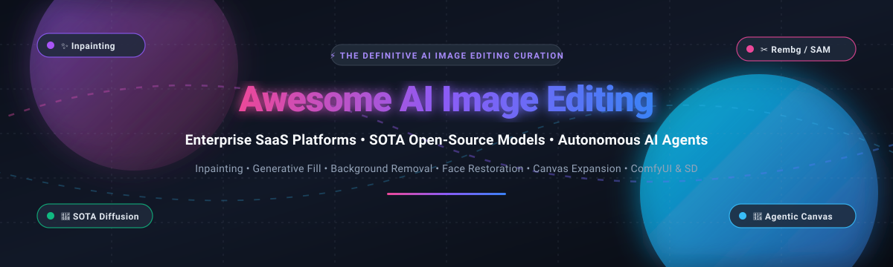
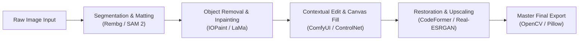

  

# 🎨 Awesome AI Image Editing 🚀

> 🌟 **The definitive, curated landscape of enterprise SaaS tools, state-of-the-art open-source neural models, and autonomous AI agents transforming digital image editing.**
> 
> *Covering Inpainting, Generative Fill, Background Removal, Deep Matting, Face Restoration, Neural Super-Resolution, and Multi-Modal Agent Orchestration.*

---

## 📑 Table of Contents

- [📊 Sector Overview & Market Dynamics](#-sector-overview--market-dynamics)
- [🏢 SaaS / Hosted Platforms](#-saas--hosted-platforms)
- [💻 Open-Source GitHub Projects](#-open-source-github-projects)
- [🛠️ Architecture & Integration Recipes](#️-architecture--integration-recipes)
- [🤝 How to Contribute](#-how-to-contribute)
- [💖 Support](#-support)
- [⭐ Star History](#-star-history)
- [⚖️ Disclaimer & Compliance](#️-disclaimer--compliance)

---

## 📊 Sector Overview & Market Dynamics

The global AI image editing and generative vision market is estimated at **$5.1B–$7.8B in 2025/2026** and is projected to expand past **$48B+ by 2035**, sustaining a blistering CAGR of **22.7% to 30.9%**.

The market displays a **moderately fragmented barbell dynamic**:
- **Enterprise Core Platforms (High Concentration):** Incumbents like Adobe and Canva anchor creative agency workflows through broad multi-tool ecosystems, tight enterprise governance, and proprietary model training (Firefly).
- **Specialized Vertical SaaS:** Disruptors like Photoroom and Pixelcut capture fast-growing e-commerce product staging, social commerce, and mobile marketplace sellers.
- **The Open-Source Commoditization Wave:** Permissively licensed foundation models (LaMa, SAM 2, Rembg, Real-ESRGAN) and execution engines (ComfyUI, SD-WebUI, IOPaint) continuously lower development barriers, empowering developers and enterprises to host completely autonomous, cost-effective, self-contained editing pipelines without cloud lock-in.

---

## 🏢 SaaS / Hosted Platforms

Below is a benchmark of top SaaS solutions comparing commercial pricing tiers, strict free limits, and enterprise scale, sorted by company valuation / revenue:

| Product | Pricing (Starting Tier) | Free Tier / Trial Limits | Company Scale (Valuation / Revenue) | Key Features & Capabilities |
| :--- | :--- | :--- | :--- | :--- |
| **[Adobe Photoshop](https://www.adobe.com/products/photoshop.html)** | $19.99/mo (Photography bundle) or $22.99/mo (Photoshop standalone) | 7-day free trial (Full unrestricted desktop/web access; payment details required) | ~$93B Market Cap / ~$26.6B ARR | Industry-standard raster editor with Firefly Generative Fill, canvas expansion, layer inpainting, and C2PA Content Credentials provenance. |
| **[Canva](https://www.canva.com/)** | $14.99/mo ($119.99/yr for Canva Pro) | Free plan forever (5 GB cloud storage, standard templates; limited Magic Studio AI generations, background remover paywalled) | ~$35B Valuation / ~$4B ARR | Cloud collaborative design platform featuring Magic Studio: Magic Eraser, AI Background Remover, Magic Expand, and text-to-graphics. |
| **[Clipdrop (Jasper)](https://clipdrop.co/)** | $15/mo (Clipdrop Pro) or Jasper Pro at $59/mo | Free plan forever (Capped daily: ~20 uses/24h for Background Removal/Cleanup/Relight/x2 Upscaling; exports watermarked/compressed) | ~$1.5B Valuation (Parent: Jasper) / ~$100M+ ARR | Fast developer-friendly AI suite with Cleanup object removal, Uncrop outpainting, Relight, Sky Replacement, and batch processing APIs. |
| **[Photoroom](https://www.photoroom.com/)** | $4.99/week or ~$9.99/mo (~$69.99/yr for Pro) | Free plan forever (Standard background removal with mandatory Photoroom watermark; ~100 exports/mo, non-commercial use only) | $500M Valuation / ~$94M ARR | E-commerce and studio product photography platform with batch cutout, generative AI staging backdrops, and shadow synthesis. |
| **[Topaz Labs](https://www.topazlabs.com/)** | $12/mo (Image Web) or $19–$39/mo (Desktop Photo AI / Gigapixel) | No permanent free tier; 48-hour money-back trial window on paid subscriptions (Promotional web trial capped at ~10 credits) | ~$340M Acquisition Valuation / ~$10M–$50M ARR | Deep-learning desktop enhancement suite specializing in generative upscaling (Gigapixel), artifact denoising, and motion blur sharpening. |
| **[Remove.bg](https://www.remove.bg/)** | $9.00/mo (40 credits/mo) or $1.99–$4.99 pay-as-you-go packs | Free plan forever (Unlimited web background removals capped at low-resolution previews ~0.25 MP; 1 free high-res HD credit on sign-up) | ~$100M Acquisition Valuation (Kaleido/Canva) | Hyper-fast, one-click automated background removal service backed by extensive developer REST APIs and e-commerce plugin connectors. |
| **[Skylum (Luminar Neo)](https://skylum.com/luminar)** | $9.95/mo (Subscription) or $119 one-time perpetual license | 7-day free trial (Full desktop editing features without requiring credit card upfront; 30-day money-back guarantee) | ~$17.5M ARR / Private Bootstrapped | Desktop photography suite powered by neural engines for AI sky replacement, 3D atmospheric relighting, portrait retouch, and GenErase. |
| **[Pixlr](https://pixlr.com/)** | $1.49/mo (Plus, billed annually) or $6.49/mo (Premium) | Free plan forever (Ad-supported browser editor with daily export/save caps; AI Generative Fill paywalled or limited to trial credits) | ~$9M–$10M ARR (Inmagine Group) | Browser-based photo suite delivering generative fill, neural image generation, automated cutout, and batch design templates. |
| **[Pixelcut](https://www.pixelcut.ai/)** | $9.99/mo or $59.99/yr ($5.00/mo for Pro) | Free plan forever (Basic background remover capped at ~3 AI generation uses per day; batch export & 4x upscaling paywalled) | Venture-backed Seed (~$2M–$5M ARR est.) | Mobile- and web-first AI product photography editor tailored for e-commerce merchants, social media sellers, and creators. |
| **[Photopea](https://www.photopea.com/)** | $9.00/mo (Single Account Ad-Free) or $5.00/mo (billed annually) | Free plan forever (100% full feature access to all Photoshop/PSD tools, supported by sidebar display advertisements) | ~$2.8M ARR / Solo-founder Bootstrapped | Zero-install browser-based raster graphics suite with native support for PSD, AI, XCF, Sketch, and XD formats. |

---

## 💻 Open-Source GitHub Projects

Self-hosted, permissively licensed, and transparent machine learning repositories for image manipulation, segmented inpainting, matting, restoration, and pipeline orchestration.

*Ranked strictly by GitHub stargazers count (descending):*

1. **[AUTOMATIC1111 / stable-diffusion-webui](https://github.com/AUTOMATIC1111/stable-diffusion-webui)**   
   *AGPL-3.0* • The definitive browser interface for Stable Diffusion. Delivers comprehensive interactive inpainting, outpainting, sketch-guided generation, prompt matrix adjustments, and extensive community extension support.

2. **[comfyanonymous / ComfyUI](https://github.com/comfyanonymous/ComfyUI)**   
   *GPL-3.0* • Highly modular node-based graphical user interface and backend execution engine for Stable Diffusion, SDXL, and Flux. Enables procedural generation pipelines, complex inpainting workflows, ControlNet conditioning, and repeatable automated pipelines.

3. **[opencv / opencv](https://github.com/opencv/opencv)**   
   *Apache-2.0* • The premier real-time computer vision and image processing foundation library. Provides high-performance C++ and Python primitives for classical inpainting (Navier-Stokes, Fast Marching), filtering, color spaces, transformations, and DNN inferencing.

4. **[storytold / photocraft](https://github.com/storytold/photocraft)**   
   *Open-Source (TypeScript / Next.js)* • SOTA agent-driven generative canvas and multi-modal image manipulation suite. Uses conversational LLM orchestration across Gemini, OpenAI, and Anthropic alongside local tools for natural language image editing, matting, and batch operations.

5. **[facebookresearch / segment-anything](https://github.com/facebookresearch/segment-anything)**   
   *Apache-2.0* • Meta AI's foundation model for zero-shot promptable image segmentation (SAM). Enables one-click semantic mask extraction for objects, backgrounds, and regions—forming the primary segmentation backbone for modern inpainting tools.

6. **[TencentARC / GFPGAN](https://github.com/TencentARC/GFPGAN)**   
   *Apache-2.0* • Practical algorithm for real-world blind face restoration using Generative Facial Prior (GFP) and spatial feature transform layers. Restores degraded, compressed, or AI-synthesized facial portraits.

7. **[xinntao / Real-ESRGAN](https://github.com/xinntao/Real-ESRGAN)**   
   *BSD-3-Clause* • Practical super-resolution algorithm designed to upscale and de-noise real-world images and digital artwork, recovering fine textures and crisp contours post-editing.

8. **[lllyasviel / ControlNet](https://github.com/lllyasviel/ControlNet)**   
   *Apache-2.0* • Revolutionary neural network architecture adding spatial conditioning controls (Canny edges, depth maps, surface normals, human poses, and segmentation masks) to diffusion-based image generation and editing pipelines.

9. **[invoke-ai / InvokeAI](https://github.com/invoke-ai/InvokeAI)**   
   *Apache-2.0* • Professional studio-grade creative engine for visual generative AI. Features a dedicated unified canvas for layer-based inpainting, outpainting, brush management, and enterprise local GPU deployments.

10. **[danielgatis / rembg](https://github.com/danielgatis/rembg)**   
    *MIT* • Production-grade background removal library and CLI utility powered by U2-Net, IS-Net, and BiRefNet. A transparent, open-source alternative to Remove.bg with Python bindings and Docker support.

11. **[Sanster / IOPaint](https://github.com/Sanster/IOPaint)**   
    *Apache-2.0* • Top-rated open-source inpainting and object removal desktop application (formerly Lama-Cleaner). Integrates SOTA models (LaMa, MAT, Manga, Stable Diffusion Inpainting, PowerPaint) with web UI, CLI, plugins, and REST APIs.

12. **[facebookresearch / segment-anything-2](https://github.com/facebookresearch/segment-anything-2)**   
    *Apache-2.0* • Meta AI's SAM 2 architecture unifying real-time visual prompt segmentation across both images and video with memory attention mechanisms and dramatically higher precision.

13. **[sczhou / CodeFormer](https://github.com/sczhou/CodeFormer)**   
    *NTU S-Lab License* • Robust blind face restoration algorithm based on a discrete Codebook Lookup Transformer. Formulates portrait restoration as a code prediction task to eliminate severe compression artifacts and unnatural blurring.

14. **[easydiffusion / easydiffusion](https://github.com/easydiffusion/easydiffusion)**   
    *GPL-3.0* • The easiest one-click installable distribution of Stable Diffusion for Windows, Mac, and Linux. Ships complete with canvas inpainting, face correction, upscaling, and zero complicated Python dependency setups.

15. **[advimman / lama](https://github.com/advimman/lama)**   
    *Apache-2.0* • Large Mask Inpainting (LaMa) using fast Fourier convolutions (FFCs). Capable of reconstructing repetitive textures and extensive missing regions in high-resolution photography without distortion.

16. **[xuebinqin / U-2-Net](https://github.com/xuebinqin/U-2-Net)**   
    *Apache-2.0* • Deep salient object detection framework utilizing nested U-structure (ReSUT). The benchmark architecture driving automated portrait matting and zero-effort background extraction.

17. **[timothybrooks / instruct-pix2pix](https://github.com/timothybrooks/instruct-pix2pix)**   
    *MIT* • Groundbreaking conditional diffusion model trained to edit images directly from conversational natural language instructions (e.g., *"make it look like sunset"*, *"turn the cat into a tiger"*).

18. **[fenglinglwb / MAT](https://github.com/fenglinglwb/MAT)**   
    *Custom Research License* • Mask-Aware Transformer for high-resolution image inpainting. Re-engineers attention mechanisms to handle large, non-contiguous holes while preserving long-range spatial dependencies.

19. **[DQiaole / ZITS_inpainting](https://github.com/DQiaole/ZITS_inpainting)**   
    *MIT* • Incremental Transformer Structure for image inpainting. Combines positional encodings and structure-restoration modules for zero-shot image reconstruction on complex scenes.

---

## 🛠️ Architecture & Integration Recipes

To build a **self-hosted, production-grade image editing platform** without cloud licensing fees:

- **Inpainting & Eraser:** **[IOPaint](https://github.com/Sanster/IOPaint)** with the **[LaMa](https://github.com/advimman/lama)** backend.
- **Background Extraction:** **[Rembg](https://github.com/danielgatis/rembg)** or **[SAM 2](https://github.com/facebookresearch/segment-anything-2)**.
- **Facial Enhancement:** **[CodeFormer](https://github.com/sczhou/CodeFormer)** or **[GFPGAN](https://github.com/TencentARC/GFPGAN)**.
- **Resolution Upscaling:** **[Real-ESRGAN](https://github.com/xinntao/Real-ESRGAN)** (2x / 4x models).
- **Agentic Orchestration:** **[PhotoCraft](https://github.com/storytold/photocraft)** to bind vision models with natural language command agents.

---

## 🤝 How to Contribute

We welcome contributions from photographers, ML researchers, and open-source developers!

1. 🍴 **Fork the repository** on GitHub.
2. 🌿 **Create a descriptive branch**: `git checkout -b feature/add-new-image-tool`.
3. 📝 **Add your entry** following our strict table/list formatting with verified links, licenses, and Stars_Badges.
4. 🚀 **Submit a Pull Request** explaining your tool's differentiators and benchmark use cases.

---

## 💖 Support

If this curated repository saved you hours of research or assisted your creative engineering pipelines:

- ⭐ **Star this repository** to help others discover it.
- 🍴 **Fork and share** with your developer and creator communities.
- ☕ **Buy me a coffee & support ongoing research** via the [GitHub Sponsors Dashboard](https://github.com/sponsors/ishandutta2007)! Every contribution fuels regular updates and community maintenance.

---

## ⭐ Star History

---

## ⚖️ Disclaimer & Compliance

- **Community Curation:** This repository is an independent community catalog for educational and research purposes. Inclusion does not imply official endorsement.
- **Regulatory Disclosure:** Commercial operators must adhere to regional AI safety and copyright legislation (e.g., EU AI Act Article 50 watermark disclosures, Adobe C2PA Content Credentials provenance standards).
- **License Vigilance:** Check individual repo licenses before commercial deployment (e.g., LaMa and IOPaint are permissive Apache-2.0; CodeFormer carries non-commercial research clauses).
- **Ethics in Restoration:** Generative face restoration models (GFPGAN, CodeFormer) synthesize plausible details and should never be used to fabricate photographic identity in evidentiary or journalistic contexts.

---

  <b>Built with ❤️ for creators, engineers, and visionaries building open AI image pipelines.</b>

